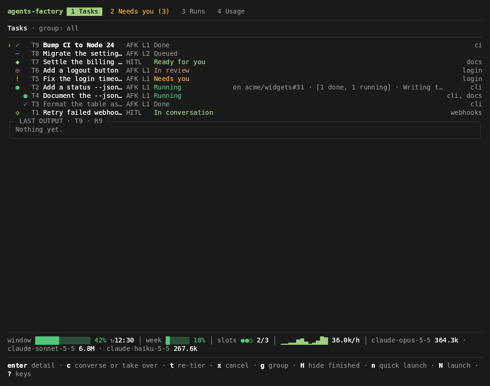
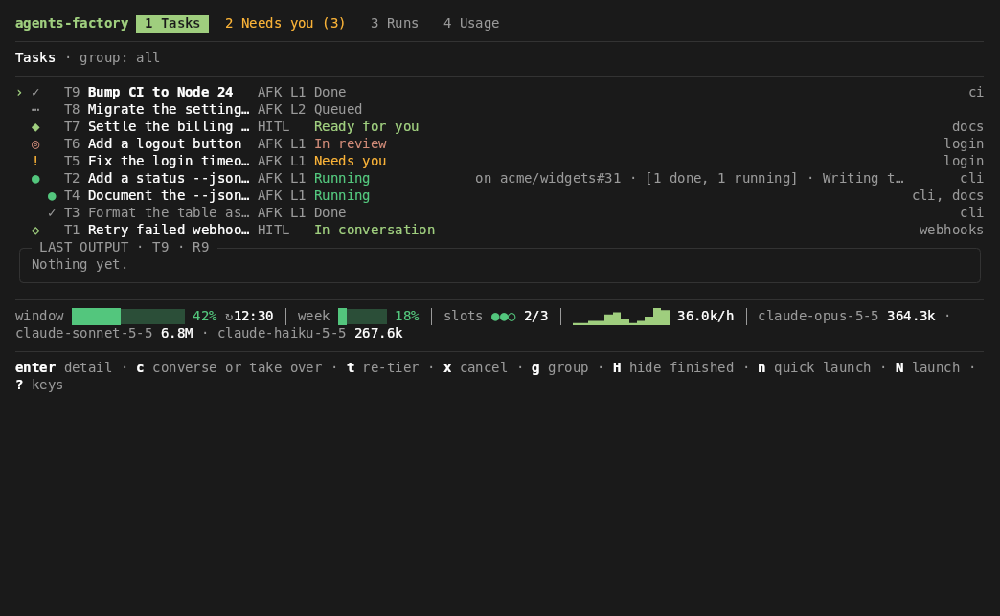
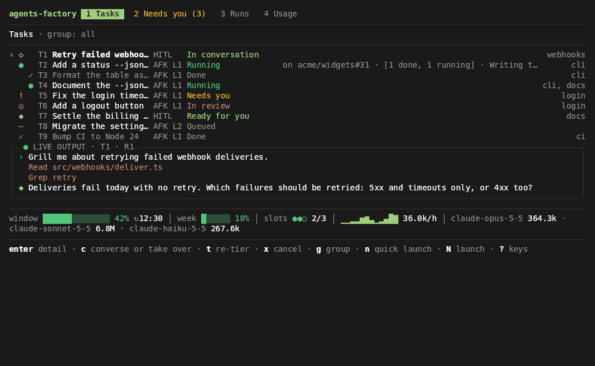
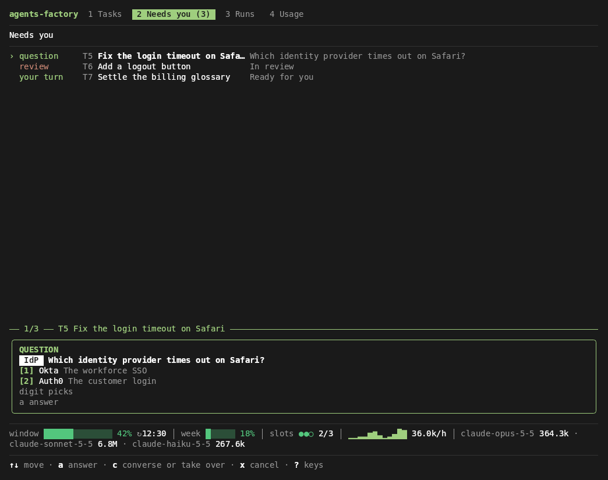
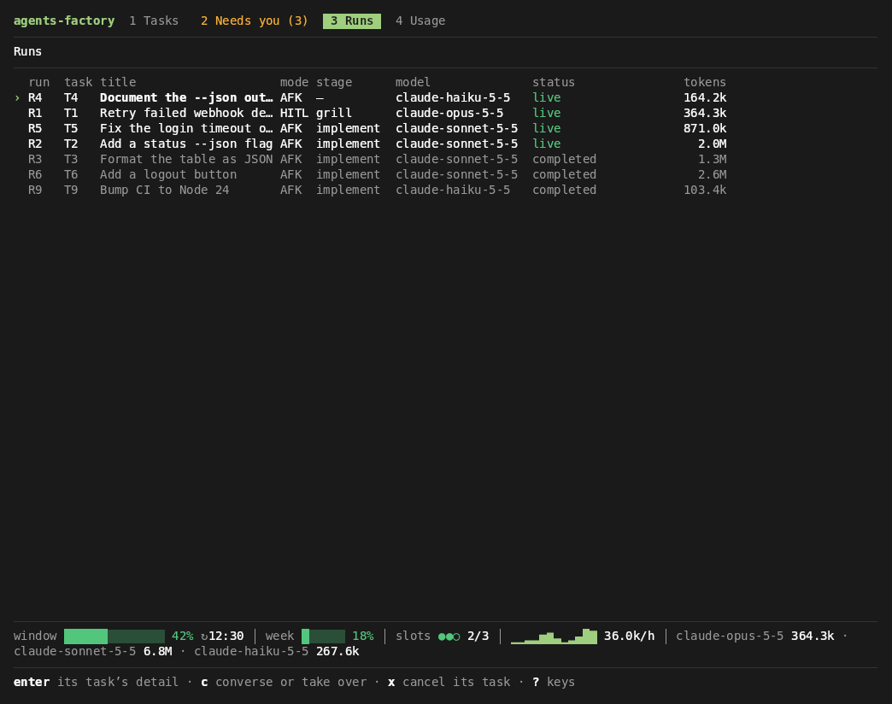
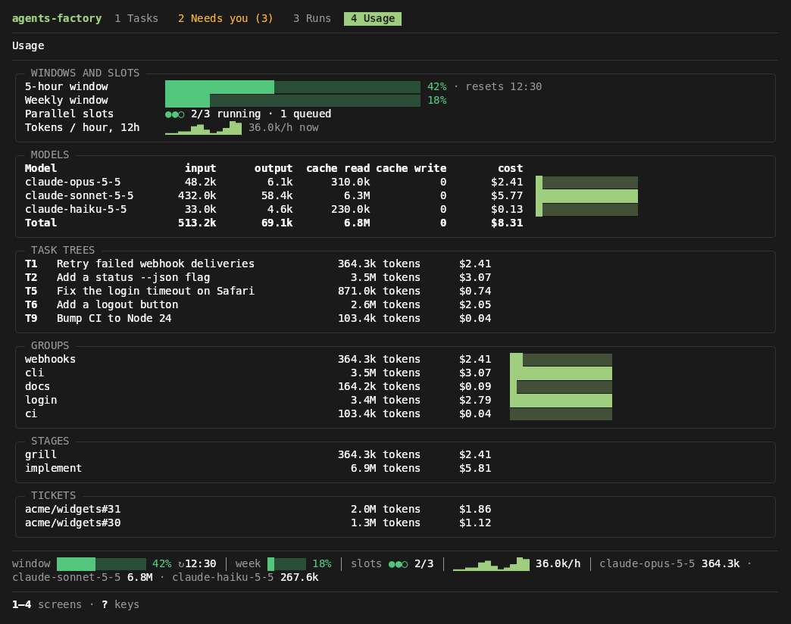
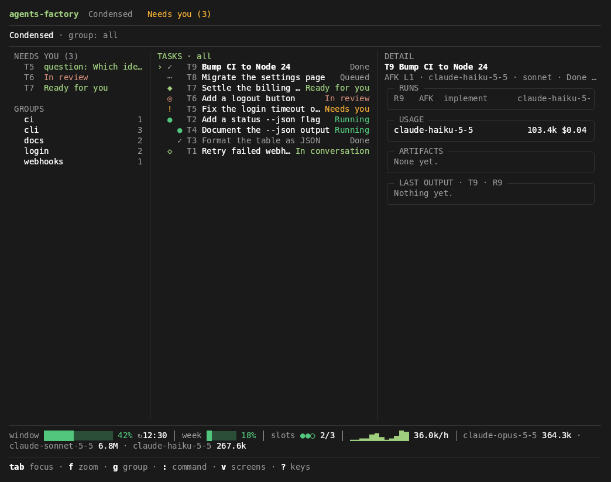

# agents-factory

A local-first factory where one operator launches, groups, steers and reviews work delegated to Claude agents. Work runs from live conversation through to unattended end-to-end delivery. A daemon owns the runs and a terminal UI (TUI) drives them. You talk to an agent in a **HITL** (human in the loop) conversation, then hand the task off to an **AFK** (unattended) run that implements it on its own branch.



## Prerequisites

- **Node.js 24 or later.** The factory runs its TypeScript sources directly, with no build step.
- **A Claude subscription**, signed in to Claude Code with `/login`. The factory drives runs through the Claude Agent SDK with its bundled Claude Code, never your installed `claude` ([ADR 0001](docs/adr/0001-agent-sdk-executes-every-run.md)).
- **git** and the **GitHub CLI** (`gh`).
- **Docker Desktop**, only for L2 runs, which run sandboxed in a container of their own ([ADR 0007](docs/adr/0007-autonomy-bounds-containment-and-publishing.md)). L1 runs on your machine.

The factory is built and tested on Windows 10 with Windows Terminal ([findings](docs/walking-skeleton.md)). For the intended colours, install the [Windows Terminal colour scheme](docs/windows-terminal-scheme.md).

## Installation

The package is private and not published to npm. Install it from a clone:

```bash
git clone https://github.com/kevinverreault/agents-factory
cd agents-factory
npm install
npm link
```

`npm link` puts the `agents-factory` command on your `PATH`.

## One-time setup

```bash
agents-factory setup github          # create the factory's own GitHub App, in your browser
agents-factory repo add ~/code/widgets
agents-factory setup token           # only for L2 runs: paste what `claude setup-token` prints
```

- `setup github` creates the GitHub App the factory writes to GitHub as: it is the sole GitHub writer ([ADR 0004](docs/adr/0004-factory-is-sole-github-writer.md)).
- `repo add` registers one of your clones (the current directory when you give no path). It also tells you if the App isn't installed on the repository yet, or if the repository needs the skill set's setup ([ADR 0010](docs/adr/0010-factory-registers-operator-clones.md)).

## Running the TUI

```bash
agents-factory
```

With no arguments, `agents-factory` opens the TUI, and starts the daemon first if none is running. Closing the TUI leaves the daemon and its runs going ([ADR 0002](docs/adr/0002-daemon-owns-runs.md)). Press `?` on any screen for its keys.

## A tour of the TUI

The media below are recorded from the real TUI on a made-up factory ([how](#re-recording-the-media)).

### Tasks, and launching one

The **Tasks** screen (`1`) shows the task tree. Under it is the selected task's live output, and the usage strip runs along the bottom. `n` quick-launches a prompt: the agent asks at most three questions on a small card, then hands off. `N` opens the full launch card, where you pick the repository, the workflow preset and the stage to start at.


### Needs you

**Needs you** (`2`) queues everything waiting on you: an agent's question or permission request, a failed run, a task in review, a HITL task ready for you. The selected item's answer sheet is under the list. Press `a`, then a digit, to answer it.


### A task's detail and its conversation

`enter` drills into a task's detail: its runs, usage, artifacts and live output. `enter` again opens its conversation, where you talk to a HITL run. `ctrl+b` takes you back.



### Advancing and handing off

A task follows its **workflow preset**, a sequence of stages ([presets](docs/presets.md)). When the agent proposes moving on, `ctrl+n` opens the advance sheet onto the next stage. `/handoff` opens the handoff sheet (so does `ctrl+h`, in a terminal that tells it apart from Backspace, which Windows Terminal does not). There, you review the brief the agent wrote and pick the autonomy level, then `enter` hands the task off to an unattended run.



### The other screens

The stills below show Needs you with its answer sheet. **Runs** (`3`) lists every run, live ones first. **Usage** (`4`) shows the usage windows, the parallel slots, and tokens and API-equivalent cost by model, task tree, group, stage and ticket. `v` switches to the condensed view: Needs you, the task tree and the selected task's detail, side by side.

| Needs you | Runs |
|---|---|
|  |  |
| **Usage** | **Condensed view** |
|  |  |

## Commands

| Command | What it does |
|---|---|
| `agents-factory` | Open the TUI, starting the daemon if none is running |
| `agents-factory daemon status \| daemon stop` | Show the daemon's status, or stop it |
| `agents-factory repo add [path] [--base-branch <branch>] [--default-preset <preset>]` | Register a clone |
| `agents-factory repo move <new-path>` | Point a registered repository at its clone's new path |
| `agents-factory repo remove <owner/name> [--anyway]` | Unregister a repository |
| `agents-factory skills update \| skills status` | Move the skill set pin, or show it |
| `agents-factory models update` | Move each model tier to the model this factory ships |
| `agents-factory setup github [--name <app-name>]` | Create the factory's GitHub App |
| `agents-factory setup token` | Store the subscription token L2 runs use |
| `agents-factory keep-awake on \| keep-awake off` | Keep the machine awake, or not, while AFK runs are active |
| `agents-factory slots <n>` | Set how many AFK runs may be active at once (8 by default) |
| `agents-factory gc` | List the leftovers that belong to no live task, and delete only those you tick |

## Learn more

- [GLOSSARY.md](GLOSSARY.md): the factory's language (task, run, stage, mode, autonomy level, and more).
- [docs/presets.md](docs/presets.md): workflow presets, and how to write your own.
- [docs/adr/](docs/adr/): the architecture decisions.
- [docs/windows-terminal-scheme.md](docs/windows-terminal-scheme.md): the TUI's colours in Windows Terminal.

### Re-recording the media

The GIFs and screenshots in `docs/media/` come from scripted scenes in `src/demo/scenes.ts`, played on the real TUI over a made-up factory (`src/demo/demo-factory.ts`). The demo's connection answers the TUI's commands as the daemon would, so a scene is only keys and text, and recording needs no daemon, GitHub or Claude credentials. Two recorders play the same scenes:

```bash
npm run media:vhs                  # with vhs (needs vhs, ttyd and ffmpeg on the PATH): the GIFs
npm run media                      # headless, with npm packages only: the GIFs and the screenshots
npm run media -- handoff           # only the scenes named
npm run media -- --text needs-you  # print a scene's frames as text instead
npm run tapes                      # rewrite docs/media/tapes/*.tape after changing a scene
npm run demo                       # look around the same made-up factory, interactively
```

The committed media were drawn by the headless recorder, because vhs can't run inside an L2 run's container. [docs/media/README.md](docs/media/README.md) explains why, and how to record with vhs instead. `npm test` checks every scene still reaches its key moments, and that the committed tapes match the scenes.
